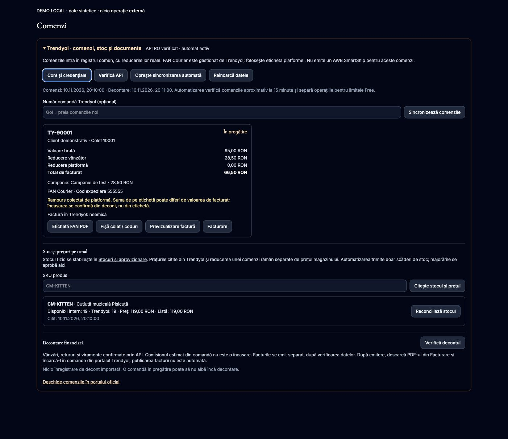
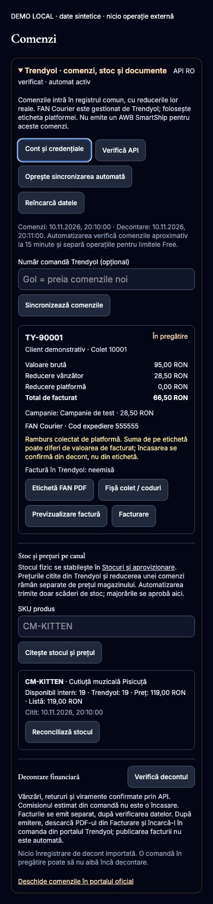

# Trendyol RO — comenzi, inventar, documente și decontare

## Starea livrării

10 noiembrie 2026. Ramură `codex/trendyol-order-sync-20261110`, bază `33898e9`, separată de AVYRON. Codul și migrarea append-only **0095** sunt livrate prin [PR #99](https://github.com/AvyronTech/cutiutamagica/pull/99). Acest raport păstrează probele de implementare; receipt-ul final din PR consemnează commitul, distribuția Workerului, schema și importul efectiv în producție. O simulare locală nu înlocuiește acel receipt. În această etapă nu s-au emis facturi, creat AWB-uri, schimbat prețuri sau executat plăți/rambursări.

În producție sunt salvate identitatea contului oficial Trendyol RO și credențialele existente, prin mecanismul criptat al magazinului. Citirile autentificate oficiale au confirmat comanda, inventarul, documentul FAN și cele șase categorii financiare. Simplul mesaj „Cheie configurată” din versiunea veche nu este o verificare a noului conector.

Datele personale, numerele reale de comandă/colet, PDF-ul de transport și cheile API nu sunt incluse în repository. Capturile sunt DEMO cu date sintetice.

## Fluxul implementat

1. **Integrări → Trendyol**: profilul vânzătorului și JSON `sellerId`, `apiKey`, `apiSecret`, `storeFrontCode: RO`, criptat cu mecanismul existent. „Verifică API” face o citire autentică; schimbarea sellerului după inițializare este blocată pentru reconciliere.
2. **Comenzi → Trendyol**: preluare Order V2 după număr, toate coletele acelei comenzi, sau stream paginat după ultima modificare. O singură comandă centrală pentru seller/număr; hash, versiune și batch atomic previn dublurile și actualizările vechi. Divizările incomplete, SKU necunoscut, totalurile contradictorii și modificările unei comenzi deja facturate sunt trimise la verificare.
3. **Inventar comun**: SKU exact → variantă activă. Stocul fizic se confirmă explicit, fără a deriva automat cantități din marketplace. Rezervările existente gestionează disponibilul, consumul la expediere și eliberarea la anulare. Un retur nu este repus automat în vânzare. Importul repetat nu mai consumă încă o bucată.
4. **Prețuri**: valoarea brută, reducerea comerciantului, reducerea platformei și totalul de facturat sunt preluate din comanda efectivă. Prețul curent/listă al listării se citește separat. Eticheta unei promoții nu este transformată într-un procent presupus, iar prețurile magazinului nu sunt suprascrise.
5. **Transport Trendyol**: FAN Courier și documentul deja generat de platformă. Descărcare privată a PDF-ului, fișă colet cu SKU/coduri și previzualizare nefiscală. SmartShip refuză aceste comenzi în backend; nici statusul lor nu poate fi modificat manual prin ruta generică.
6. **Facturare existentă**: se folosește adresa de facturare, cu fallback la cea de livrare când lipsește. Acest lucru evită facturarea pe adresa unui locker. Previzualizarea nu emite un document și nu consumă un număr. Emiterea rămâne o operație explicită în Facturare; pentru Trendyol sunt verificate reconcilierea recentă și existența unei facturi externe. După emitere, PDF-ul se descarcă din Facturare și se încarcă în portalul Trendyol. **Transmiterea facturii către Trendyol nu este automatizată în acest lot.**
7. **Decontare**: citire idempotentă și paginată pentru Sale, Return, PaymentOrder, DeductionInvoices, CreditNote și CommissionInvoice. Se păstrează doar câmpurile financiare necesare, inclusiv precizia originală a comisionului/venitului. Un ramburs de pe etichetă, un comision estimat sau simpla livrare nu marchează comanda drept încasată. Registrul extern este separat de încasările confirmate ale magazinului.
8. **Stoc către Trendyol**: după recuperarea comenzilor și rezolvarea alertelor, sunt trimise numai cantități absolute, fără prețuri. Scăderile sunt automate, majorările cer acțiunea administratorului. O acceptare de batch nu este confirmare finală: se recitește stocul sau rezultatul oficial al batchului. Răspunsul incert nu este retrimis automat.
9. **Automatizare Free**: triggerul orar și coada existente, patru verificări de comenzi pe oră, procesare izolată pentru stoc și finanțe. Automatizarea este oprită implicit și se activează numai după verificarea contului și a stocului. Mesajele de coadă conțin doar versiunea și tipul operației.

## Cazul operațional verificat

Comanda reală a fost validată prin API și simulată cu același adaptor și registru SQLite local, cu zero erori de chei străine. Stocul fizic și bucata rezervată au fost confirmate explicit de administrator în conversație, fără presupuneri din disponibilul marketplace. Scenariul sintetic din teste folosește 95,00 lei brut, 28,50 lei reducere și 66,50 lei de facturat; 20 fizice, una rezervată și 19 disponibile.

**Diferență de reconciliat:** eticheta oficială FAN indică o sumă de ramburs diferită de totalul de facturat din Order V2. Valorile reale și documentul sunt păstrate în artefactele private și conversație. Documentul a fost descărcat și verificat vizual, fără modificare și fără generarea unui AWB nou. Valoarea de facturat nu a fost înlocuită cu rambursul, iar diferența nu a fost clasificată ca taxă/discount în lipsa dovezii. Toate cele șase citiri financiare au răspuns HTTP 200, fără înregistrări în intervalul verificat. Încasarea/decontul final rămân de confirmat când sunt publicate de Trendyol.

Particularități confirmate cu răspunsul real: coletul poate avea `supplierId=0`; este acceptat numai dacă fiecare linie atestă sellerul autentificat. Comanda are ramburs colectat de platformă (`isCod=true`), fără a transforma această valoare în încasare locală. Documentul RO folosește în prezent o redirecționare API-object → S3 semnat; fiecare pas este validat separat, fără transmiterea Authorization către stocarea documentelor.

## Protecții și limite

- Autentificare administrativă, SameOrigin și RBAC în backend: citire comenzi, scriere comenzi/inventar, configurare integrări și acces financiar distincte. Răspunsuri și documente `private, no-store`; fără secrete în frontend sau loguri.
- Origine API fixă, JSON limitat, timeouturi și erori fără corpuri upstream. PDF: HTTPS, domenii/căi oficiale permise, redirecționări limitate și validate, maximum 5 MB și antet PDF.
- Noile tabele cu referințe la comenzi sunt excluse din backupurile fără date de clienți. Gruparea exportului păstrează bugetul de interogări Free după creșterea schemei.
- Pollingul la aproximativ 15 minute nu rezervă atomic inventarul în checkoutul altei platforme. Majorările automate sunt blocate tocmai pentru a evita refacerea stocului pe baza unei comenzi externe încă nepreluate.
- La un timeout de scriere fără ID de batch, sincronizarea stocului rămâne în verificare. Nu se presupune eșec și nu se retrimite automat; operatorul trebuie să verifice operația în portal/API înaintea unei reluări.
- Facturile emise nu sunt rescrise de o actualizare de status. Liniile lor rămân asociate; orice schimbare a conținutului financiar cere reconciliere.
- Free păstrează limita CPU și întreruperile posibile 1102 acceptate anterior de administrator. Cozile, cursorul persistent și importurile idempotente reduc efectele, fără a promite absența lor.
- Nu sunt activate servicii plătite, MFA, integrare AVYRON, chei noi sau permisiuni suplimentare ale contului Trendyol.

## Verificări

Verificări locale finalizate: **531 teste în 89 fișiere**, plus **38 teste focalizate** după ultimele ajustări; typecheck, lint, build, deploy dry-run, security:check (zero constatări), npm audit (zero vulnerabilități) și git diff --check trecute. CI și producția se verifică separat la publicare. Suita include import repetat, statusuri întârziate, rezervare/consum/anulare, lipsă/insuficiență stoc, izolare de SmartShip, blocarea editării manuale, păstrarea referințelor facturilor, roluri, SSRF documente, credite/debite și precizie financiară, update de stoc fără prețuri și timeout fără retrimitere.

UI demonstrativ verificat în Opera la desktop și 390/320 px: fără depășire orizontală, câmpuri etichetate și acces din tastatură. Aceste capturi nu reprezintă dovadă a activării în producție.

## Activare și revenire

După aprobarea publicării: verifică din nou ramurile și schema live; păstrează un bookmark D1; aplică 0095 înainte de Worker; verifică API-ul și actualizează stocul CM-KITTEN la cantitatea fizică aprobată, apoi importă comanda reală. Confirmă o singură comandă, o rezervare și disponibil 19; citește stocul marketplace și documentele, apoi activează automatizarea. Nu emite o factură în timpul testelor.

Pentru rollback: oprește întâi automatizarea. Revino la Workerul anterior dacă este necesar, păstrând tabelele append-only, comanda reală, istoricul și rezervările. Nu șterge o comandă reală sau mișcări de inventar pentru a reveni la o versiune de cod. Migrarea nu se rescrie după aplicare.

Denumirea confirmată **Cutiuta Muzicala Intro Harry Potter WB** este păstrată. Migrarea are corecții condiționate strict pentru vechile texte; nu rula seeduri vechi peste conținutul actualizat în producție.

## Surse oficiale

- [Order V2](https://developers.trendyol.com/v3.0/docs/2-get-shipment-packages)
- [Stream](https://developers.trendyol.com/v3.0/docs/get-shipment-packages-stream)
- [Reprezentarea reducerilor](https://developers.trendyol.com/v3.0/docs/discount-representations-in-the-get-shipment-packages-service)
- [Finanțe și decontare](https://developers.trendyol.com/v3.0/docs/1current-account-statement-integration)
- [Stoc și preț](https://developers.trendyol.com/v3.0/docs/9-stock-and-price-update-1)
- [Rezultatul batchurilor](https://developers.trendyol.com/v3.0/docs/check-batchrequest-result)
- [Eticheta oficială](https://developers.trendyol.com/v3.0/docs/1-getting-common-label-getcommonlabel)
